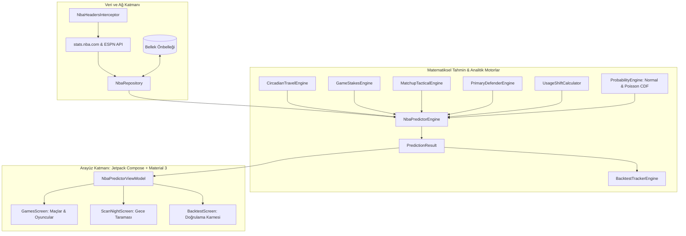

# NBA Predictor (Native Android) — Mimari ve Matematiksel Şartname

Bu doküman, `nbabahis` sisteminin Android platformuna saf Kotlin ve Jetpack Compose ile sıfırdan port edilen **NBA Oyuncu İstatistikleri & Tahmin Motoru**'nun teknik mimarisini, formüllerini ve derleme yapısını belgeler.

---

## 1. Sistem Tasarımı ve Katmanlar

Uygulama, harici sunucuya veya Python çalışma zamanına ihtiyaç duymadan cihaz üzerinde yerel (on-device) çalışan Clean Architecture ve MVVM desenine sahiptir:



---

## 2. Çekirdek Matematiksel ve Analitik Formüller

### 2.1. Üstel Ağırlıklı Hareketli Ortalama (EWMA)
Oyuncunun sezon ortalaması ile yakın geçmiş formu arasındaki denge:
$$\text{Projeksiyon}_{\text{baz}} = (0.45 \times \text{L3}) + (0.35 \times \text{L5}) + (0.20 \times \text{Sezon Ort})$$
- $\text{L3}$: Son 3 maç ortalaması (en yüksek volatilite ve güncel form ağırlığı).
- $\text{L5}$: Son 5 maç ortalaması.
- $\text{Sezon Ort}$: Sezon geneli taban performansı.

### 2.2. Sirkadiyen Ritim, Jetlag & Deplasman Turu (`CircadianTravelEngine.kt`)
- **Zaman Dilimi Kayması ($\Delta \text{TZ}$):**
  $$\text{Ceza}_{\text{Doğuya Uçuş}} = \min(0.06, |\Delta \text{TZ}| \times 0.02) \quad (\text{Zaman kaybı / Uyku bölünmesi})$$
  $$\text{Ceza}_{\text{Batıya Uçuş}} = \min(0.03, |\Delta \text{TZ}| \times 0.01)$$
- **Kümülatif Deplasman Turu Yükü ($N_{\text{away}}$):**
  $$F_{\text{road}} = \begin{cases} 0.00 & N_{\text{away}} = 1 \\ 0.02 & N_{\text{away}} = 2 \\ 0.045 & N_{\text{away}} = 3 \\ 0.07 & N_{\text{away}} \ge 4 \end{cases}$$
- **Rakım Şoku (Denver 5280 ft / Utah 4226 ft):**
  $$\text{Hedef Rakım} \ge 5000\text{ ft} \land \text{Geliş Süresi} < 24\text{ saat} \implies \text{Ceza}_{\text{Rakım}} = 0.05$$

### 2.3. Birebir Savunmacı Eşleşme Matrisi (`PrimaryDefenderEngine.kt`)
Oyuncunun karşısına çıkacak birincil savunmacının $D_{\text{FG\%Diff}}$ (Savunulan şut yüzdesi sapması) ve savunmacı seviyesine göre skor etkisi:
- **Elit Kilit Savunmacı (Jrue Holiday, Derrick White, Rudy Gobert):**
  $$M_{\text{PTS}} = 0.90 + \left(\frac{D_{\text{FG\%Diff}}}{100}\right) \times 0.5 \quad (\text{Skor: } -10\% \text{ ila } -15\%)$$
- **Zayıf Savunma Hedefi (Trae Young, Jordan Poole):**
  $$M_{\text{PTS}} = 1.08 + \left(\frac{D_{\text{FG\%Diff}}}{100}\right) \times 0.2 \quad (\text{Skor: } +8\% \text{ ila } +12\%)$$

### 2.4. Dinamik Tempo ve Taktiksel Şema (`MatchupTacticalEngine.kt`)
İki takımın karşılaşmasındaki gerçek top kullanma adedi (Possessions):
$$\text{Pace Multiplier} = \frac{\text{TeamPace} \times \text{OppPace}}{99.0 \times 99.0}$$
- **Drop Coverage:** Çemberi koruyan pivotlara karşı guard 3'lük hacmi ($3PM \times 1.12$).
- **Switch Defense:** Sürekli el değiştiren savunmaya karşı asist hacmi daralır ($AST \times 0.90$).
- **Blitz / Trap:** Yıldıza ikili sıkıştırmada asist fırsatları artar ($AST \times 1.14$), top kaybı artar ($TOV \times 1.20$).

### 2.5. Olasılık Dağılımı ve Barem Analizi (`ProbabilityEngine.kt`)
Bahis baremleri için Normal Dağılım ve Poisson Kümülatif Dağılım Fonksiyonu (CDF):
- **Sayı/Ribaund/Asist için Gauss CDF:**
  $$P(X > \text{Barem}) = 1 - \Phi\left(\frac{\text{Barem} - \mu}{\sigma}\right) = \frac{1}{2}\left[1 - \text{erf}\left(\frac{\text{Barem} - \mu}{\sigma \sqrt{2}}\right)\right]$$
- **Top Çalma / Blok için Poisson CDF:**
  $$P(X \le k) = e^{-\lambda} \sum_{i=0}^{k} \frac{\lambda^i}{i!}$$

### 2.6. Model Kalibrasyonu ve Hata Doğrulama (`BacktestTrackerEngine.kt`)
Gerçekleşen değer ($y_i$) ile tahmin edilen değer ($\hat{y}_i$) arasındaki başarım:
$$\text{MAE} = \frac{1}{n} \sum_{i=1}^{n} |y_i - \hat{y}_i|, \quad \text{RMSE} = \sqrt{\frac{1}{n} \sum_{i=1}^{n} (y_i - \hat{y}_i)^2}$$
$$\text{Hit Rate} = \frac{\text{Başarılı Olan Yüksek Olasılıklı Baremler}}{\text{Toplam Değerlendirilen Baremler}} \times 100$$

---

## 3. Dizin Yapısı ve Dosyalar

```text
android/
├── app/
│   ├── build.gradle.kts                   # Bağımlılıklar (Compose BOM 2024.05, OkHttp 4.12, Gson 2.11)
│   ├── src/main/
│   │   ├── AndroidManifest.xml           # İnternet izinleri ve Activity tanımı
│   │   └── java/com/nbabahis/app/
│   │       ├── MainActivity.kt           # Ana Activity ve ekranlar arası Crossfade geçişleri
│   │       ├── data/
│   │       │   ├── api/
│   │       │   │   ├── NbaApiService.kt  # stats.nba.com, ESPN API & offline fallback
│   │       │   │   └── NbaHeadersInterceptor.kt # Resmi NBA stats HTTP başlıkları
│   │       │   ├── model/               # NbaPlayer, NbaGame, PlayerGameLog, TeamStats
│   │       │   └── repository/
│   │       │       └── NbaRepository.kt # Çoklu seviye önbellek ve orkestrasyon
│   │       ├── domain/
│   │       │   ├── engine/
│   │       │   │   ├── NbaPredictorEngine.kt      # Ana tahmin orkestratörü
│   │       │   │   ├── PrimaryDefenderEngine.kt   # Birebir savunmacı etki matrisi
│   │       │   │   ├── CircadianTravelEngine.kt   # Jetlag & yolculuk yorgunluk motoru
│   │       │   │   ├── GameStakesEngine.kt        # Playoff & lig önemi motoru
│   │       │   │   ├── MatchupTacticalEngine.kt   # Savunma şemaları & tempo motoru
│   │       │   │   ├── ProbabilityEngine.kt       # Normal & Poisson CDF olasılık motoru (.5 standart baremler)
│   │       │   │   ├── PlayerComparisonEngine.kt  # Kafa kafaya kıyaslama motoru
│   │       │   │   ├── HalftimeLiveEngine.kt      # Devre arası canlı maç içi projeksiyon motoru
│   │       │   │   └── BacktestTrackerEngine.kt   # Geçmiş maç doğrulama & MAE motoru
│   │       │   └── model/                         # PredictionResult, StatPrediction, Trend
│   │       └── ui/
│   │           ├── screens/
│   │           │   ├── GamesScreen.kt             # Maç listesi, oyuncu seçimi, filtreler
│   │           │   ├── ScanNightScreen.kt         # Tüm geceyi tarama ekranı
│   │           │   └── BacktestScreen.kt          # Hata payı ve isabet karnesi ekranı
│   │           └── components/
│   │               ├── GameCard.kt, PredictionCard.kt, FilterChips.kt
│   └── src/test/java/com/nbabahis/app/
│       └── domain/engine/
│           └── NbaPredictorEngineTest.kt          # İrtifa, B2B, Savunmacı & Backtest testleri
├── build.gradle.kts                               # Kök Gradle betiği
├── settings.gradle.kts                            # Proje ve modül ayarları
└── gradlew                                        # Gradle wrapper komut dosyası
```

---

## 4. Derleme ve Test Talimatları

Proje standart Android Studio ortamında doğrudan açılabilir veya Termux / Linux terminalinde derlenebilir:

```bash
# Testleri çalıştırma
./gradlew test

# Hata ayıklama APK'sı üretme
./gradlew assembleDebug
```
Üretilen APK konumu: `app/build/outputs/apk/debug/app-debug.apk`
